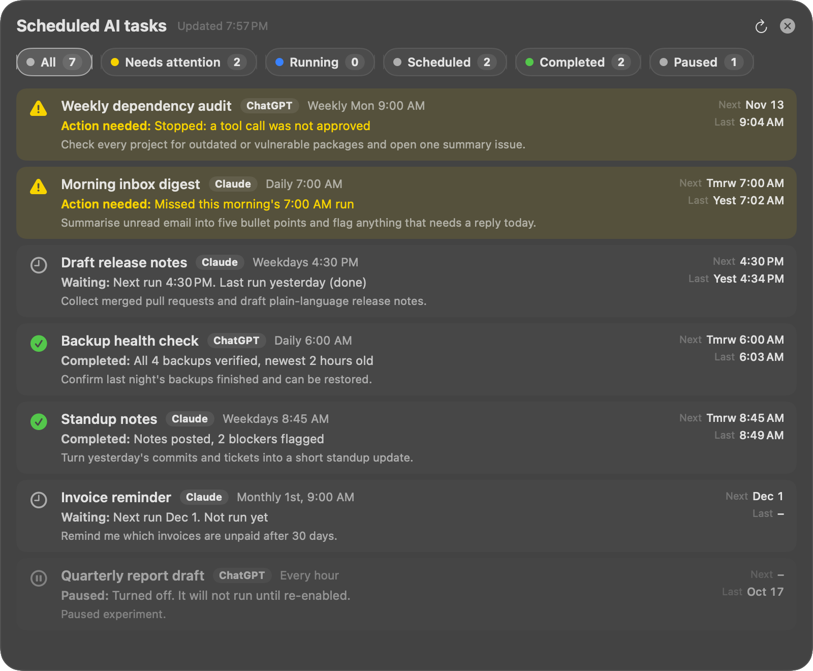

# AI Tasks Widget

A macOS desktop widget that shows the scheduled tasks you set up in the **Claude desktop app** and the **ChatGPT desktop app (Codex automations)** in one place, and tells you at a glance which ones finished, which ones are still waiting to run, and which ones need you.

- **Yellow: needs attention.** The last run hit an error, stopped part-way (for example a tool call was not approved while you were away), is waiting on you, or a scheduled run never happened.
- **Green: completed.** The last run finished cleanly today.
- **Grey: scheduled.** Nothing has run yet for today's slot. Shows when the next run is.



*The expanded list, shown with made-up sample tasks.*

> Not affiliated with, endorsed by, or supported by Anthropic or OpenAI. "Claude" and "ChatGPT" are trademarks of their owners. Read the [disclaimer](#disclaimer) before installing.

## Why it exists

Scheduled AI tasks run while you are not watching. When one stops part-way, for example because it asked for permission to run a command and nobody was there to approve it, the app often still lists the run as finished. You only find out when you go looking. This widget does the looking for you and puts every task from both apps on your desktop with an honest status.

## Features

- **A real macOS widget** (WidgetKit) in small, medium and large sizes, for the desktop or Notification Center.
- **Both apps in one list:** Claude scheduled tasks and ChatGPT/Codex automations, merged and sorted with the ones needing attention first.
- **Honest status:** a run that stopped part-way counts as needing attention, even when the app itself lists it as succeeded.
- **Missed runs:** if a scheduled time passed more than 2 hours ago and nothing ran (the Mac was asleep, the app was closed), the task turns yellow.
- **Expanded list:** the expand button opens a panel beside the widget listing every task, with filters at the top (All, Needs attention, Running, Scheduled, Completed, Paused). It shows All by default; click one or more filters to show only those. Each task shows what it is waiting on, the action needed, or what it completed, plus its next and last run.
- **Click to open:** clicking a task opens the app it belongs to.
- **Readable in every desktop state,** including the faded look macOS gives desktop widgets while another app is in front.
- **Read-only and offline:** it only reads files already on your Mac. It never changes your tasks, never sends anything over the network, and has no accounts, analytics or telemetry.

## Requirements

- A Mac with **Apple silicon** (M1 or later). Intel Macs need one change, see [Customising](#customising).
- **macOS 14 Sonoma or later.** Developed and tested on macOS 27.2.
- **Apple's Command Line Tools** (free, includes the Swift compiler and Python 3). Install with `xcode-select --install`. Full Xcode is not needed.
- At least one of:
  - the **Claude desktop app** with scheduled tasks, and/or
  - the **ChatGPT desktop app that includes Codex automations** (bundle ID `com.openai.codex`).

Scheduled "Tasks" you create on chatgpt.com in a browser are stored on OpenAI's servers, not on your Mac, so this widget cannot see them.

## Install

```bash
git clone https://github.com/IncreaseWebDev/ai-tasks-widget.git
cd ai-tasks-widget
./build.sh
./install-login-item.sh
```

Then add the widget: **right-click the desktop, choose Edit Widgets, search "AI Tasks"**, and drag the size you want onto the desktop.

What the two scripts do:

- `build.sh` compiles the widget and its helper into `build/AI Tasks.app` and signs it locally ("ad hoc" signing; no Apple developer account needed).
- `install-login-item.sh` copies the app to `~/Applications`, registers the widget with macOS, and adds a login item (a LaunchAgent) so the helper starts at login and restarts if it crashes.

The widget may show "No data yet" for up to a minute after installing while the helper does its first read.

## Uninstall

```bash
./uninstall.sh
```

This stops the helper, removes the login item, and moves the app and its data file to a temporary folder. Then right-click the widget on your desktop and choose Remove Widget. Nothing in Claude's or ChatGPT's own data is touched.

## How it works

There are two parts, both inside `AI Tasks.app`:

1. **The widget** (`widget/Widget.swift`) draws the list. macOS requires every widget to run in a sandbox, so the widget is not allowed to read Claude's or ChatGPT's data folders, and it can only refresh itself every 15 minutes or so.
2. **The helper** (`helper/main.swift`) runs in the background with no window, Dock icon or menu. Every 60 seconds it runs `collector/collect.py`, which reads both apps' local data and writes a single file, `~/Library/Application Support/AITasksWidget/status.json`. That folder is the only place the widget has read access to. When the data changes, the helper tells macOS to redraw the widget. The helper also handles the widget's links (open an app, open the expanded list).

`shared/Model.swift` holds the data model used by both.

### Where the data comes from

Everything is read-only.

**Claude desktop app**

- Task list and schedules: `~/Library/Application Support/Claude/claude-code-sessions/<account>/<org>/scheduled-tasks.json`
- Each task's prompt and description: `~/.claude/scheduled-tasks/<task>/SKILL.md`
- Each run: a session file (`local_*.json`) in the same folder, tagged with the task's ID. Its outcome comes from the recorded error, the run's end-of-turn summary, whether it is waiting on you, and whether it was cut short. For a cut-short run, the end of its transcript (`~/.claude/projects/*/<session>.jsonl`) shows whether a tool call was refused.

**ChatGPT desktop app (Codex)**

- Automations: `~/.codex/sqlite/codex-dev.db`, table `automations` (status, schedule, next and last run). Also mirrored in `~/.codex/automations/<id>/automation.toml`.
- Runs: cron automations are logged in the `automation_runs` table. "Heartbeat" automations add a turn to an existing conversation, read from `~/.codex/thread_history_1.sqlite`.

### Status rules

| Status | When |
|---|---|
| Needs attention | The latest run errored, was cut short, is waiting on you, or reported something blocked; or a scheduled time passed more than 2 hours ago with no run. Stays yellow until a later run replaces it. |
| Running | A run is in progress (activity in the last 3 minutes). |
| Completed | The latest run finished cleanly today, or in the current slot for tasks that run more than once a day. |
| Scheduled | Nothing has run yet for today's slot. Shows the next run time. |
| Paused | The task is turned off. Hidden in the widget; listed in the expanded panel. |

## Customising

- **App identifier:** the app uses `local.aitasks` by default. To use your own, set it for both scripts: `BUNDLE_PREFIX=com.yourname.aitasks ./build.sh` and `BUNDLE_PREFIX=com.yourname.aitasks ./install-login-item.sh` (and the same for `uninstall.sh`).
- **Intel Mac:** in `build.sh`, change `TARGET="arm64-apple-macos14.0"` to `TARGET="x86_64-apple-macos14.0"`.
- **Status timings** (missed-run grace period, "running" window, how long finished one-time tasks stay listed) are constants at the top of `collector/collect.py`.
- **Check what the collector sees:** `/usr/bin/python3 collector/collect.py --print` prints the merged task list in the terminal.

## Troubleshooting

- **"AI Tasks" is not in the widget gallery.** Run `pluginkit -m -p com.apple.widgetkit-extension | grep -i aitasks`. If nothing is listed, run `./install-login-item.sh` again. If it is listed but missing from the gallery, check for crash reports in `~/Library/Logs/DiagnosticReports/AITasksWidgetExtension-*.ips`.
- **The widget says "No data yet".** The helper is not running. Check with `launchctl print gui/$(id -u)/local.aitasks` (or your `BUNDLE_PREFIX`), or run `./install-login-item.sh` again.
- **One source shows an error.** Claude or ChatGPT changed its internal file format in an update. The other source keeps working. Please open an issue with the error text.
- **Reading system logs:** in zsh, `log` is a built-in command, so use `/usr/bin/log show ...` instead.

### Build notes

These are only relevant if you change the build:

- The widget extension must be linked with `-Xlinker -e -Xlinker _NSExtensionMain`, the way Xcode links extensions. Built with Swift's default entry point it crashes at startup and never appears in the gallery. Quick check after building: running the extension binary by hand should print "An XPC Service cannot be run directly." and exit. A crash (exit code 133) means the entry point is wrong.
- When another app is in front, macOS shows the widget's light-mode render with brightness turned into transparency, which washes out light backgrounds and dark text. The widget therefore always draws itself dark.
- For screenshots, the helper can render the expanded panel to a PNG from sample data: `AITW_STATUS_FILE=$PWD/docs/sample-status.json AITW_SNAPSHOT=/tmp/panel.png "build/AI Tasks.app/Contents/MacOS/AITasksHelper"`. Regenerate the sample with `python3 docs/make_sample.py`.

## Known limits

- **It depends on private, undocumented files.** Neither Anthropic nor OpenAI publishes these formats, and either app can change them in any update without notice. When that happens, the affected source shows an error until this project is updated.
- **The Codex run rules were written from the app's database layout, without real failed runs to test against.** Treat ChatGPT statuses with more caution than Claude ones.
- **Some Claude runs keep no record.** If Claude records that a task ran but keeps no session file for that run, the outcome is unknown and the task stays grey with "Ran 6:05 AM, no result saved" rather than green.
- **"Running" is inferred** from recent activity, not reported by the apps.
- **The expanded panel is placed from where you click,** because macOS does not tell apps where a desktop widget sits. It opens on the side of the widget with more room, up to 800 points wide and 1000 points tall.
- **Ad hoc signing:** macOS accepts locally signed widgets on the setup it was tested on, but Apple can change that.

## Privacy

The collector reads the files listed above on your own Mac and writes one summary file to `~/Library/Application Support/AITasksWidget/`. That summary includes task names, schedules, short status lines and the first part of each task's prompt. Nothing leaves your Mac: there is no network code, no analytics and no telemetry. Uninstalling removes the summary file.

## Disclaimer

**Use at your own risk.** This is an unofficial, independent hobby project, provided "as is" and "as available", without warranty of any kind, express or implied, including any warranty of merchantability, fitness for a particular purpose, accuracy, reliability or non-infringement.

**No liability.** To the fullest extent permitted by law, the author and any contributors are not liable for any claim, loss or damage of any kind, direct, indirect, incidental, special, consequential or otherwise, arising from or related to this software or its use, misuse or inability to use. That includes, without limitation, data loss, missed or failed tasks, decisions made based on what the widget shows, security issues, system instability, and any consequence of building, signing, installing or running it.

**Not affiliated.** This project is not affiliated with, endorsed by, sponsored by or supported by Anthropic, OpenAI or Apple. Claude, ChatGPT, Codex, macOS and WidgetKit are trademarks of their respective owners and are used here only to describe what the software works with.

**Not a source of truth.** The statuses shown are this project's interpretation of private files that can change at any time. Always check the Claude or ChatGPT app itself before relying on whether a task ran or succeeded.

**Your responsibility.** You are responsible for reviewing the code before you run it, for complying with the terms of service of any app or service it reads data from, and for any use you make of it. No support, updates or fixes are promised.

## License

[PolyForm Noncommercial License 1.0.0](LICENSE). In plain terms, and not as legal advice:

- **You may** use, copy, modify and share this software for any noncommercial purpose: personal use, study, hobby projects, and use by charities, schools, and public research or government organisations.
- **You may not** use it for any commercial purpose, including selling or reselling it, including it in a paid product or service, or using it for commercial advantage, without separate written permission from the copyright holder.
- Anyone you share it with must receive the license terms and the `Required Notice` line at the top of the [LICENSE](LICENSE) file.

The [LICENSE](LICENSE) file is the binding text; this summary does not change it.

Copyright Corey Benoit.
